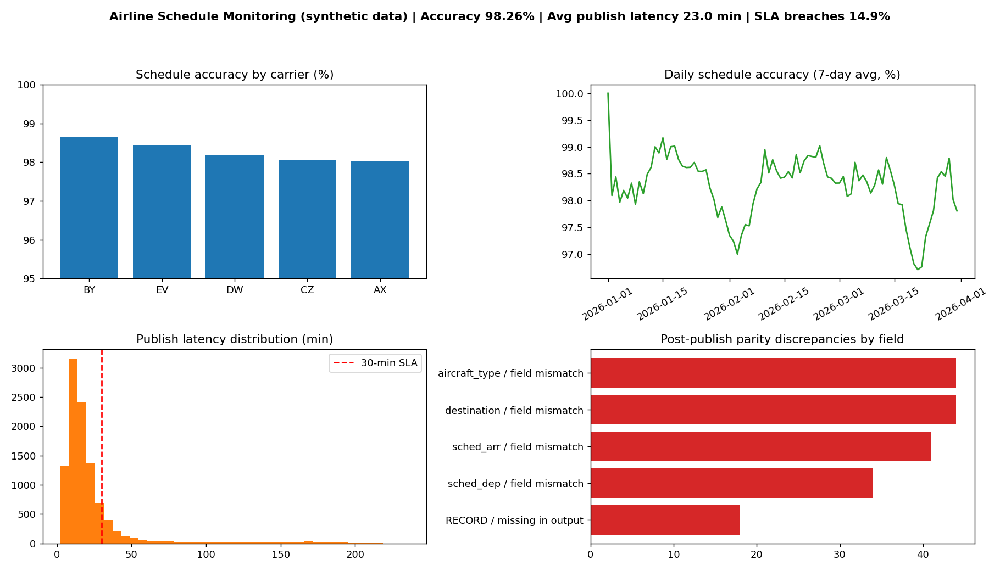

# Airline Schedule Monitoring & Reporting Dashboard

**Stack:** Python (pandas) | SQL (SQLite) | Power BI

Monitors whether flight schedules published to downstream channels match the master schedule, and reports
**schedule accuracy**, **publish latency** and **parity discrepancies** across 10,000+ records.

> **Data note:** all data is **synthetic** (generated by `src/generate_data.py`, fixed random seed). Carrier codes are
> fictional. Error rates were set by me to simulate realistic publishing problems; results below describe this simulation,
> not any real airline.



## What it does
1. **Generate** a simulated master schedule (10,400 flights), a staged copy and a distributed (published) copy
   with injected errors, missing records and publish delays.
2. **Parity checks (Python):** compare master vs staged (*pre-publish*) and master vs distributed (*post-publish*),
   field by field (carrier, flight no., origin, destination, departure, arrival, aircraft).
   Designed to run on every publish batch or on a schedule.
3. **SQL layer:** load into SQLite, build a reporting view, and compute KPIs by carrier, by day, and by field.
4. **Power BI:** import `powerbi_exports/` and build the dashboard (DAX measures in `docs/POWERBI_BUILD_GUIDE.md`).

## Results on the simulated data
| Metric | Value |
|---|---|
| Scheduled flights | 10,400 |
| Pre-publish discrepancies caught | 152 flights (1.46%) |
| Post-publish: matched / mismatched / missing | 10,219 / 163 / 18 |
| **Schedule accuracy** | **98.26%** |
| Avg publish latency | 23.0 min |
| Publish SLA breaches (> 30 min) | 14.94% |

## Repo structure
```
src/        generate_data.py, parity_check.py, build_sql_and_exports.py, make_dashboard_preview.py
sql/        schema.sql (tables + view), queries.sql (KPI queries)
data/       master, staged and distributed CSVs (synthetic)
outputs/    parity check results
powerbi_exports/  tables for Power BI
docs/       dashboard preview + Power BI build guide
```

## How to run
```bash
pip install -r requirements.txt
python src/generate_data.py
python src/parity_check.py
python src/build_sql_and_exports.py
python src/make_dashboard_preview.py
```
